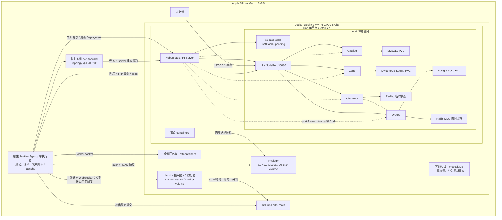
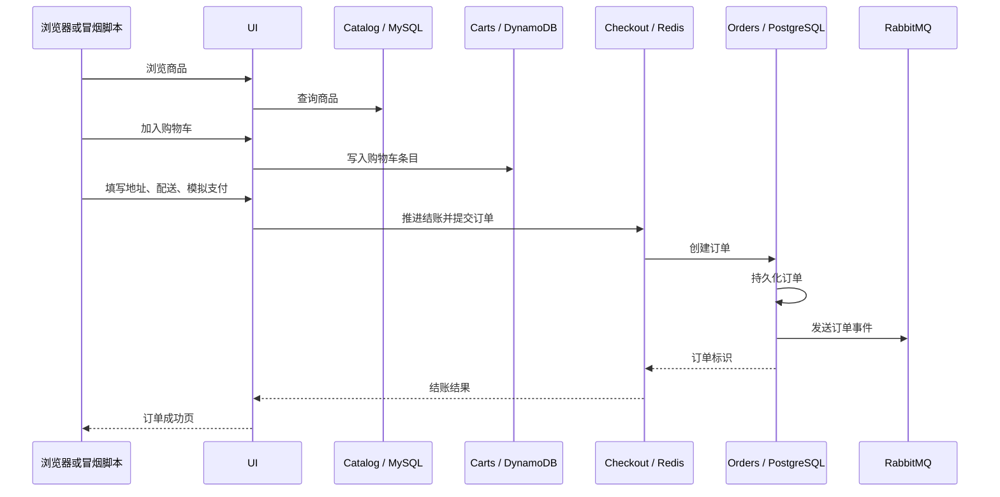
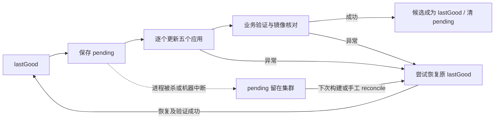

# 本地网店、Kubernetes 与 Jenkins：现状架构

原始运行快照：2026-11-03 11:04–11:10；评审修订：2026-11-03，Asia/Shanghai。本文描述已经落地的系统；历史设计见 [DESIGN.md](DESIGN.md)，操作步骤见 [RUNBOOK.md](RUNBOOK.md)，验收证据见 [IMPLEMENTATION.md](IMPLEMENTATION.md)。

## 1. 当前结论

完整网店与 Jenkins 发布链路已经在这台 Mac 上运行。五个应用、五个依赖运行于本地单节点 kind；Jenkins 控制器和镜像仓库运行于 Docker Desktop；构建 Agent 是 Mac 原生进程。本期没有创建或使用 AWS 云资源。

源码提交已经走通过真实测试、镜像构建、推送、顺序发布、完整下单、订单读回和发布记录。发布中断恢复、数据库 Pod 重建、实验容器 stop/start、Docker Desktop 重启均有实际验证。**Mac 整机重启尚未验收；Deploy/Verify 失败自动回滚、recoveryFailed 后修复发布尚未做真实集群故障注入。** 本轮新增脚本回归测试覆盖这些分支，不能替代集群演练。

这是一套个人学习环境：单机器、单节点、单副本，发布和重启允许短暂不可用。当前没有高可用、备份恢复自动化、真实支付或生产安全隔离。

### 1.1 实时快照与版本关系

| 项目 | 核验时状态 |
| --- | --- |
| Fork | [HangerLIN/retail-store-sample-app](https://github.com/HangerLIN/retail-store-sample-app)，分支 `main` |
| 上游 | [aws-containers/retail-store-sample-app](https://github.com/aws-containers/retail-store-sample-app) |
| 本地目录 | `/Users/lth/Documents/ChatGPT/k/retail-store-sample-app` |
| 本文编写前仓库 HEAD | `ac1521c07314328f05dc197ad33f6a0c5556d04f`，Docker Desktop 重启验收记录 |
| 当前已验证应用源码 | `2c9886e3b48a41c7c8f5d07d6c34aa6c54427e9d`，由 Jenkins #5 发布 |
| 最近 Jenkins 作业 | [#8 SUCCESS](http://127.0.0.1:8080/job/retail-local/8/)，核验时没有运行中的构建 |
| 集群 | `retail-lab`，节点 `retail-lab-control-plane` 为 Ready |
| 业务工作负载 | `retail` 命名空间内 10/10 Pod Running、Ready |
| 持久卷声明 | MySQL、PostgreSQL、DynamoDB 三个 PVC 均 Bound，各 1 GiB |
| 发布状态 | `lastGood` 存在，`pending` 不存在，已记录版本的 `recoveryFailed=false` |
| 线上 digest 与 lastGood | 原始快照及本轮配置接纳演练恢复后均 5/5 一致 |
| 网店入口 | [http://127.0.0.1:8888](http://127.0.0.1:8888)，本次只读访问返回 HTTP 200 |
| Jenkins 入口 | [retail-local](http://127.0.0.1:8080/job/retail-local/) |

仓库 HEAD 与运行应用源码不同是预期行为：#5 之后是文档提交，流水线检查后跳过重新构建和发布。判断正在运行什么，应看 `release-state.lastGood` 和 Deployment 的镜像摘要，不能只看 GitHub 最新提交。HTTP 200 是本次在线快照，完整业务成功的证据来自已完成的发布与重启验收，二者不混用。

## 2. 部署架构与边界



这里有两层容器运行环境：Docker Desktop 运行 Jenkins、Registry 和 kind 节点容器；节点内部由 containerd 运行 Kubernetes Pod。Agent 使用 Docker 构建镜像，不是直接往节点的 containerd 导入镜像。节点通过 Registry 拉取已发布的摘要。

Jenkins 不部署在 Kubernetes 里，因此重建应用 Pod 不影响控制器；但它们仍共享同一个 Docker VM 和同一台 Mac。Docker Desktop 停止时，整个实验环境都会中断。

### 2.1 网络与访问路径

| 入口或链路 | 当前实现 |
| --- | --- |
| 网店 | `127.0.0.1:8888 → kind:30080 → ui Service:80 → UI Pod:8080` |
| Jenkins | `127.0.0.1:8080 → retail-jenkins:8080`；Agent 使用 WebSocket，未开放独立 TCP Agent 入口 |
| Registry | Mac 使用 `localhost:5001`；节点通过 `hosts.toml` 将该镜像域名解析到 `http://retail-registry:5000` |
| Kubernetes API | 当前映射为 `127.0.0.1:57904 → 节点:6443`；重建可能变化，以 kubeconfig 为准 |
| 后端业务 | Catalog、Carts、Checkout、Orders 均为 ClusterIP，Service 80 → 容器 8080 |
| 数据库 | 仅集群内服务：MySQL 3306、DynamoDB 8000、PostgreSQL 5432、Redis 6379、RabbitMQ 5672/15672 |
| 冒烟读后端 | Agent 用受限身份建立 `127.0.0.1` 临时 port-forward；完成后关闭 |

网店、控制器、Registry、kind API 的宿主机映射仅绑定回环地址。其他项目 TimescaleDB 的 5432 端口不属于这套访问边界。没有 Ingress、域名、TLS、NetworkPolicy 或公网入口。

[node-config.sh](scripts/node-config.sh) 配置 Registry 内部网络、containerd `hosts.toml`、代理绕过与 kubelet 参数。kind 重建后必须重新执行；本机代理地址不能直接作为节点里的代理地址使用。

## 3. 应用职责与业务调用链

| 应用 | 源码 | 技术与职责 | 真实依赖 |
| --- | --- | --- | --- |
| UI | [src/ui](../src/ui/) | Java / Spring Boot / Thymeleaf，商品、购物车、结账页面和后端调用 | Catalog、Carts、Checkout、Orders |
| Catalog | [src/catalog](../src/catalog/) | Go / Gin，商品查询 | MySQL，数据库 `catalog` |
| Carts | [src/cart](../src/cart/) | Java / Spring Boot，购物车条目 | DynamoDB Local，表 `Items` |
| Checkout | [src/checkout](../src/checkout/) | Node.js / NestJS，配送和结账流程 | Redis、Orders HTTP API |
| Orders | [src/orders](../src/orders/) | Java / Spring Boot，创建、查询订单并发送事件 | PostgreSQL，数据库 `orders`；RabbitMQ |

前端已经包含在项目中，不需要另起 React/Vue 项目。UI 提供服务端渲染页面；浏览器主要访问 UI，再由 UI 调用集群内服务。可选搜索功能关闭；当前验收不覆盖 AI 功能。



这是示例支付流程，没有连接支付机构。图展示逻辑链路，不承诺数据库写入与消息发送具有跨系统事务或恰好一次语义。RabbitMQ 配置了示例非持久队列，当前没有把业务消费者处理结果纳入验收。

## 4. Kubernetes 工作负载与数据

所有工作负载均为一个副本。五个应用使用 Deployment，发布策略为 `maxSurge=0 / maxUnavailable=1`：避免新旧应用同时占用额外资源，代价是单个服务发布时会有不可用窗口。

| 工作负载 | 控制器 | 内存 request / limit | 数据位置或用途 |
| --- | --- | --- | --- |
| `ui` | Deployment | 512 / 512 MiB | 无业务 PVC |
| `catalog` | Deployment | 256 / 256 MiB | 商品存于 MySQL |
| `carts` | Deployment | 512 / 512 MiB | 购物车存于 DynamoDB |
| `checkout` | Deployment | 256 / 256 MiB | 结账状态存于 Redis |
| `orders` | Deployment | 512 / 512 MiB | 订单存于 PostgreSQL |
| `catalog-mysql` | StatefulSet | 128 / 512 MiB | 1 GiB PVC |
| `carts-dynamodb` | StatefulSet | 256 / 512 MiB | 1 GiB PVC，`/data` |
| `orders-postgresql` | StatefulSet | 128 / 384 MiB | 1 GiB PVC |
| `orders-rabbitmq` | StatefulSet | 128 / 384 MiB | `emptyDir`，不保证消息恢复 |
| `checkout-redis` | Deployment | 32 / 96 MiB | 临时状态，允许丢失 |

五个应用均有 HTTP readinessProbe：Java 应用使用 `/actuator/health/readiness`，Catalog、Checkout 使用 `/health`。当前五个依赖没有 readinessProbe；Pod 显示 Ready 不足以证明数据库已经接受请求。发布最后还必须跑完整业务验证。全环境一起启动时，应用可能因依赖尚未可用而退出，再由 Kubernetes 重启恢复。

### 4.1 持久化的实际边界

StorageClass `retail-retain` 使用 `rancher.io/local-path`，`reclaimPolicy=Retain`、`WaitForFirstConsumer`。三个 PVC 为 RWO，数据位于 kind 节点所使用的 Docker 本地存储，未配置独立的 Mac 备份目录或远程存储。

- 普通应用或数据库 Pod 重建：预期保留数据，已实测。
- 停止再启动同一批容器：预期保留数据，已实测。
- Docker Desktop 重启：已验证订单和购物车保留。
- PVC 删除：Retain 避免自动回收底层卷；恢复绑定需要管理员处理，不是自动恢复。
- 删除 kind 集群、删除底层卷或 Docker 数据重置：按数据丢失操作处理，Retain 不提供保护。
- 没有自动备份、定期导出和从备份恢复演练，不能把 PVC 当作备份。

RWO 限制挂载节点，不能在单节点上防止两个 Pod 同时打开同一文件。DynamoDB 因此采用单副本 StatefulSet，正常删除时等待旧 Pod 完全结束后再创建同名 Pod。禁止用 force delete 验证这一保证。

DynamoDB Local 使用 `-sharedDb -dbPath /data`，没有 `-inMemory`；用户、组和 fsGroup 为 1000，堆上限 256 MiB。已观察到 `shared-local-instance.db`，避免凭据或 region 改变后意外切换数据库文件。

### 4.2 Carts 的必要源码修复

[DynamoDBCartService.java](../src/cart/src/main/java/com/amazon/sample/carts/services/DynamoDBCartService.java) 保留 `createTable` 配置名，但 `true` 的含义已改为“缺表才创建”：

1. 表存在时不删除；缺表才调用建表。
2. 捕获并发初始化的 `ResourceInUseException`，随后统一检查。
3. 等待表和 GSI ACTIVE，最长约 30 秒。
4. 检查表主键 `id`、GSI `idx_global_customerId` 的键 `customerId` 和 ALL 投影；不兼容时明确失败，拒绝删数据。

新增回归测试覆盖空库初始化、重复初始化保留数据、缺 GSI 拒绝破坏、并发初始化。不能换回上游原始 Carts 镜像，否则会失去该保护。

上游“新条目数量固定为 1”和“查询不存在条目可能 NPE”的行为未在本期修改。冒烟使用数量 1，不依赖不存在条目的删除行为。

## 5. 配置、生效证据与凭据

配置入口是 [kustomization.yaml](k8s/kustomization.yaml)。五份非敏感 ConfigMap 由生成器添加内容哈希，并通过引用进入 Pod 模板；管理员应用配置变更时，引用变化能够触发滚动。

| 服务 | 必须生效的后端配置 |
| --- | --- |
| Catalog | `mysql`，`catalog-mysql:3306`，数据库 `catalog` |
| Carts | `dynamodb`，`http://carts-dynamodb:8000`，表 `Items`，幂等建表开启 |
| Orders | `postgres`，`orders-postgresql:5432`；消息 `rabbitmq`，`orders-rabbitmq:5672` |
| Checkout | `redis`，`redis://checkout-redis:6379`；订单 `http://orders:80` |
| UI | 四个后端分别为 `http://catalog`、`http://carts`、`http://checkout`、`http://orders` |

Preflight 不尝试解释任意环境变量覆盖规则，而是比较仓库渲染结果与线上五个应用的 `env / envFrom / command / args`，同时比较 ConfigMap 内容。差异立即失败；额外 sidecar 和缺少应用 readinessProbe 也会失败。生成的 `configFingerprint` 覆盖上述配置，**不覆盖完整 PodSpec、数据库 schema 或所有基础设施配置**。

四份 Secret 使用固定名称、显式 `secretKeyRef`，不通过 `envFrom.secretRef` 导入任意键。管理员初始化检查允许的 Secret 键和明文密码环境变量；发布身份只读取不含真实 Secret 的渲染结果。该初始化检查不是持续的线上 Secret 审计。

发布后的运行时证据由四个后端 `/topology` 提供：Catalog 来自配置对象，Carts/Orders 来自 Spring 配置，Checkout 来自 ConfigService。冒烟检查 provider 与接口已暴露的 endpoint。Checkout topology 不包含 Orders endpoint，UI 也不是同样的 JSON 接口；这两部分通过配置比对和真实调用链共同验证，不声称所有端点都被 topology 覆盖。

实际密码、Agent secret 和发布 kubeconfig 仅存本地忽略目录，文件权限收紧；不在本文或 Git 中保存值。DynamoDB Local 使用的 AWS 凭据只是本地测试占位值，不是 AWS IAM 凭据。

**配置变更与镜像发布是两条操作路径。** 日常 Jenkins 只发布镜像；基础设施或配置变更由管理员审阅、应用并重新验证。若新配置指纹与 lastGood 不同，现有脚本会停止；现在提供管理员 `release.py adopt-config`：要求没有 pending/recoveryFailed、线上五个镜像等于 lastGood，等待 rollout，执行完整业务 Verify 和镜像核对，再次确认配置和镜像未变，最后带原 resourceVersion 仅替换 configFingerprint。images、sourceSha、verifiedAt 保持不变，另存配置接纳报告。操作前暂停 Jenkins，管理员应用已审阅的配置后执行；详细步骤见 RUNBOOK。此命令不适用于数据库迁移、密码轮换或镜像漂移，也不绕过配置与仓库的一致性检查。

## 6. Jenkins 与构建架构

### 6.1 控制器和 Agent

控制器容器 `retail-jenkins` 使用 `retail-jenkins-home` 卷保存作业、插件、构建记录；控制器执行器为 0。唯一 Agent `mac-agent` 标签为 `retail-mac`，一个执行器，主动通过 WebSocket 连接控制器。

Agent 由当前 macOS 用户的 LaunchAgent 启动，`RunAtLoad / KeepAlive`，登录后自动运行；这不是开机未登录即可运行的系统服务。环境脚本显式设置 Java、Node、PATH、Docker context socket、API 版本和发布 KUBECONFIG；后台进程不依赖终端中偶然存在的环境变量。

| 工具 | 当前选择 |
| --- | --- |
| Docker Desktop / Engine | 4.23.0 / 24.0.6，daemon API 1.43 |
| kind / Kubernetes / kubectl | 0.33.0 / 1.37.0 / 仓库 `env/bin/kubectl` 1.37.0 |
| Jenkins | 2.580.2；插件版本见 [plugins.txt](jenkins/plugins.txt) |
| Java | Corretto 21.0.5，Maven wrapper 随源码 |
| Node / Yarn | Node 22.23.4；直接执行仓库内 Yarn 4.11.0 脚本，安装使用 `--immutable` |
| Go | Catalog 实测 `go1.25.0 darwin/arm64`；`GOTOOLCHAIN=auto` 可能联网下载工具链，实际版本写入 `tool-versions.log` |
| 发布脚本 | Python / PyYAML 6.0.3，本机忽略目录内虚拟环境 |

构建先在原生 Mac Agent 测试和编译，再使用 [learning/docker](docker/) 打包。Java 使用 jar，Catalog 交叉编译 Linux ARM64，Checkout 打包 dist 和生产依赖。**当前运行镜像使用自定义学习 Dockerfile，不是上游 Dockerfile 的构建产物。** 当前 Checkout 生产镜像未发现 `.node` 文件，打包脚本对生产依赖新增该检查，发现即失败并要求改用 Linux 安装依赖；开发依赖里的原生模块不进入生产镜像。该检查不能证明任意依赖都跨平台兼容，迁移 AWS 时需重新设计 Linux CI，不能直接复制此 macOS 构建路径。上游 Dockerfile 保留。这样减少 Docker VM 内重复编译，但原生编译仍占整台 Mac 的 CPU 和内存。

Testcontainers 通过 Docker socket 启动隔离测试依赖；Carts、Orders、Catalog、Checkout 分别涉及 DynamoDB、PostgreSQL、MySQL、Redis。Java 测试显式适配 daemon API 1.43，socket override 为 `/var/run/docker.sock`。没有通过禁用真实测试或 Ryuk 来取得成功。

### 6.2 测试与报告

| 服务 | 实际执行 | #5 通过数量 |
| --- | --- | ---: |
| Carts | Maven clean package，包括 DynamoDB 集成测试 | 16 |
| Orders | Maven clean package，包括 PostgreSQL 集成测试 | 6 |
| UI | Maven clean package | 11 |
| Catalog | `go test -count=1 -json ./...` | 15，含子测试 |
| Checkout | `test:integration`，Jest 串行执行 | 12 |
| 合计 | 五个服务均断言实际执行数量大于零 | 60 |

Checkout 上游 `test` 的 `exit 0` 不作为测试；当前无 `src` 下单元 spec，执行的是 `test/` 下集成测试。Catalog 也不依赖上游空操作测试入口。每次作业先删除旧报告，Java 使用 clean，避免拿旧报告判成功。另有 21 项发布、配置接纳、冒烟和实际 CI shell 编排回归测试，在 preflight 中执行并归档 `release-tests.log`，包括 pending/漂移组合、recoveryFailed 强制构建、回滚失败保留 pending、Record 前后中断、CAS 冲突和跨订单误匹配。表格中的 60 项仍是 #5 的应用测试数量。

Jenkins 的 JUnit 页面收集 Java 33 项；Go JSONL、Jest JSON 与发布证据作为归档，不能把 JUnit 页面计数误认为全部测试数。只改文档或只恢复的作业不会生成一套新的测试结果，也不会冒用上一次报告。

## 7. 提交、发布与恢复

流水线入口为 [Jenkinsfile](../Jenkinsfile)，核心逻辑为 [release.py](scripts/release.py)。仅信任 Fork 的 main，每约两分钟 SCM 轮询；禁止并发，单次超时 90 分钟，普通构建保留最近 10 次；历史验收 #3–#6 已设为 Keep forever，不受普通轮转删除。#5 关键证据另存入 Git 的 [evidence/build-5.json](evidence/build-5.json)，完整五个 digest 和计数也摘入 IMPLEMENTATION。永久保留仍不是 Jenkins 卷的异地备份。

| 阶段 | 做什么 | 通过标准 |
| --- | --- | --- |
| Checkout | 拉取确定提交，清理本次报告 | 源码版本可追溯 |
| Preflight | 工具和 Docker 检查、专用 context、配置比对、验证 lastGood 五个镜像可从 Registry 获取 | 不因“网页暂时不健康”直接阻止修复；权限、配置、镜像基础错误必须停止 |
| Prepare / Reconcile | 检测 pending 或线上镜像偏离 lastGood，尝试恢复 | 正常恢复后清除 pending；特定业务恢复失败可标记后继续修复发布 |
| Needed | 对比 `lastGood.sourceSha → HEAD` | 仅 `.md`、`.mmd`、`screenshots/**` 变化可跳过；脚本、Jenkinsfile、清单变化不跳过 |
| Test and build | Orders → Checkout → Carts → Catalog → UI，先完成五个服务的测试和编译，再逐个打包推送 | 五个服务真实测试均非零且成功，构建期间无 Docker OOM 事件 |
| Deploy | 先保存 pending，再按上述顺序逐个更新镜像，每个等待 rollout，最长 240 秒 | 上一个就绪后才处理下一个，UI 最后 |
| Verify | topology、完整网店下单、Orders 读回、运行镜像证据 | HTTP 200 或 Pod Ready 均不能单独判成功 |
| Record | Verify 通过后替换 lastGood 并清除 pending | 镜像集合、源码、配置指纹和验证时间落盘到集群 |

构建描述现在区分 `deployed <sha>`、`reconcile: completed`、`skipped: docs-only or no changes since lastGood`，跳过结果为 NOT_BUILT；空 ACTION 按 deploy 处理，只有明确 reconcile 才进入恢复模式。旧 #6–#9 的 SUCCESS 是历史行为，不能据此认定发布过应用。

这是全量五服务发布，没有受影响服务分析。`learning/` 下修改脚本或清单仍是构建变更，不是整个目录都跳过。使用 lastGood 的源码作 diff 基线，使失败的源码提交不会被后来的纯文档提交掩盖。

### 7.1 镜像追溯链

构建标签为 `<完整源码SHA>-<构建号>`。镜像推送成功后，通过 Registry manifest HEAD 响应读取 `Docker-Content-Digest`，保存为 `localhost:5001/retail/<服务>@sha256:...`。Deployment 使用该不可变引用，不使用本地 image ID 代替 Registry digest。

Verify 对照部署引用、Registry manifest 和就绪 Pod 的 `status.imageID`。若 Registry 返回 OCI index，允许对应 ARM64 子 manifest 摘要，避免把合法的父子摘要差异误报为部署错误。

当前五个应用的完整引用保存在 `retail/release-state` 和 [#5 归档](http://127.0.0.1:8080/job/retail-local/5/artifact/)；五个依赖的固定本地摘要在 Kustomize 清单。Java、Node、Alpine 打包基础镜像也已固定并缓存。不能据此推断 Jenkins、kind、所有测试依赖都遵循同一套镜像发布规则。

### 7.2 发布状态与恢复边界

`retail/release-state` 是管理员预先创建的 ConfigMap，`state.json` 包含：

| 字段 | 含义 |
| --- | --- |
| `lastGood.images` | 最近一次完整 Verify 成功的五个镜像 |
| `lastGood.sourceSha` | 对应源码提交 |
| `lastGood.configFingerprint` | 本文第 5 节所述配置指纹 |
| `lastGood.verifiedAt` | 验证完成时间，UTC |
| `lastGood.recoveryFailed` | 此成功候选之前是否经历业务恢复失败 |
| `pending` | 在改动线上镜像前保存的候选，发布中断时留下 |
| 顶层 `recoveryFailed` | 准备阶段业务恢复失败，提示必须构建修复候选 |

状态更新携带此前读到的 `resourceVersion`，避免静默覆盖并发手工改动。当前没有 pending，最近 verifiedAt 为 `2026-11-02T18:42:59.119734+00:00`，即北京时间 11 月 3 日 02:42:59。



普通发布异常会尝试回滚；进程被强制终止时不能依赖异常处理，因此靠已保存的 pending 和下一次 Reconcile 恢复。若 Verify 成功但 Record 前中断，下次可能先回滚一个其实可用的版本，再重新发布，这是接受的简化。

`ACTION=reconcile` 只恢复、不构建候选，恢复失败会停止。默认 deploy 的 prepare 路径，对代码识别的业务不健康异常允许记录 `recoveryFailed` 后继续完整测试的修复候选；配置、权限、Registry 等错误仍会阻止执行。不是“所有恢复错误都忽略”。

SCM 轮询只有检测到变化才触发构建，不是定时修复器。Agent 中断或 Jenkins aborted 后，没有新提交时，需要手工运行 `ACTION=reconcile`。若镜像没有偏离且没有 pending，Reconcile 不额外执行健康巡检。

回滚恢复的是五个应用镜像，不回滚数据库数据、schema、Secret 或基础设施；没有数据库迁移兼容性框架。发布恢复不等于灾难恢复。

### 7.3 为什么可以相信“下单成功”

[smoke.py](scripts/smoke.py) 使用发布 kubeconfig，先对四个后端建立临时隧道检查 topology，再通过网店真实 HTTP 表单执行首页、商品、加购、地址、配送和模拟支付。它保留会话 Cookie，提取成功页订单 ID，最后从 Orders `/orders` 读回，按本次订单 ID 精确选择唯一对象，再检查该对象 shippingAddress 的 firstName 和 email 等于本次唯一 `smoke-*` 标记与测试邮箱。

Orders 当前查询走 repository.findAll，没有分页；冒烟数据会累积。JSON 查询有 25 秒超时和 5 MiB 响应上限，超限会失败，不会截断后当成功；当前没有自动清理测试订单。断言已限定同一订单对象，另有“标记落在其他订单”负例测试。这仍是 Orders API 读回而非数据库直连检查，独立的 PostgreSQL 重启读回进一步验证了持久化。这里没有浏览器视觉验收、压力测试或真实支付验证。

## 8. 权限与信任模型

发布身份为 `retail/jenkins-release`，专用 kubeconfig context 为 `retail-release`。流水线显式设置 `KUBECONFIG`，缺失即失败，不回退到管理员配置。

| 权限范围 | 实际授予 |
| --- | --- |
| 五个指定应用 Deployment | get / list / watch / patch，按 resourceNames 限定；脚本使用点名查询和 rollout |
| namespace 内 Pods、Services | get / list |
| Pods port-forward | get / create，已用实际 kubectl 1.37 命令验证 |
| ConfigMap | get 全命名空间；patch / update 仅 `release-state` |
| Secret、exec、PVC 删除 | 未直接授予，`auth can-i` 为 no；但 Deployment patch 可间接让 Pod 挂载 Secret，因此不是机密隔离 |

发布身份未授予 pods/log 和 events 权限；当前失败诊断主要依靠 rollout 错误、业务验证结果和 Pod 状态快照，日志及事件由管理员查询。此次不添加 AdmissionPolicy 或扩大权限。

凭据使用本地长期 ServiceAccount token，文件权限 600。Jenkins 当前仅供一个学习用户使用，无匿名读取；不是面向多团队的权限设计。

RBAC 是防误操作边界。Agent 与日常用户是同一个 macOS 身份，拥有 Docker socket，能够接触该用户的其他文件；Deployment patch 也不是只能修改 image 的细粒度权限，port-forward 可访问命名空间其他 Pod，包括数据库。因此不执行不可信 PR 或第三方脚本，不把该环境描述为恶意代码隔离沙箱。

## 9. 资源预算与可用性取舍

Mac 物理内存 16 GiB；Docker VM 6 CPU / 8 GiB。kind kubelet 预留 2 GiB，`evictionHard.memory.available=500Mi`，并保留磁盘驱逐阈值。它们影响调度和驱逐，不能给集群外的 Jenkins 建立独立内存围栏。当前没有给 kind 节点额外设置 Docker 内存硬上限。

Java 应用使用 `MaxRAMPercentage=60`；Jenkins 容器上限 1 GiB、Java 堆 512 MiB；Registry 上限 192 MiB。另一项目 `infra-timescaledb-1` 共享 VM，资源观测中计入它，实验生命周期脚本不操作它。

| 测量 | 结果与解释 |
| --- | --- |
| 本次空闲快照 | kind 2.125 GiB、Jenkins 566.3 MiB、Registry 6.6 MiB、TimescaleDB 91.3 MiB，容器用量合计约 2.77 GiB |
| #5 完整构建 | Docker 容器总体采样峰值约 3.65 GiB，Docker OOM 事件 0，控制器未重启 |
| 观测限制 | #5 约 5 秒采样可能漏瞬时峰值，且不包含原生 Mac 编译进程及完整 VM 开销；本轮新增 Mac memory_pressure/swap、Pod 前后重启及终止状态采样，结果随新构建归档；不是压力测试 |

基于已经测到的学习负载，暂保留 8 GiB Docker 配额。不能用 requests 相加或一次构建通过，推导未来任何测试和负载都不会 OOM。

单副本发布有短暂服务中断；Docker 重启后全量恢复约一分钟，Carts/Orders 曾因依赖未就绪多重启一次后恢复。没有启动顺序编排、零停机或多机容灾承诺。

## 10. 已完成验收与尚未完成项

| 验收 | 结果与证据 |
| --- | --- |
| 五服务真实测试和完整自动发布 | #5 原因经 Jenkins API 核实为 Started by an SCM change；SUCCESS，60 项测试，五个 digest、订单读回和 lastGood 均归档 |
| 发布中断 | #3 在仅 Orders 更新后终止 Agent/发布进程，保留混合版本和 pending；#4 reconcile 成功恢复 |
| 文档提交跳过 | #6 验证跳过测试和发布，不复用旧报告；lastGood 保持 #5 源码 |
| 配置漂移与发布权限 | provider 覆盖被拒绝；真实 port-forward/rollout 成功，exec/Secret/PVC 删除被拒绝 |
| Carts 与 DynamoDB 重建 | 购物车保留；连续写入时 32 次已确认写入全部保留，最多一个 DynamoDB Pod，无数据库锁错误；有一次临时请求错误，最终读回 33 条；额外条目可能是错误返回前已落库的请求，现存证据不能确定是不是重试造成，不能断言为预置数据或恰好一次 |
| MySQL / PostgreSQL 重建 | MySQL 专用验证标记保留后已清理；已有真实订单读回成功 |
| RabbitMQ 重启 | Orders 自动重连并继续下单；没有消息恢复结论 |
| 实验容器 stop/start | 容器 ID 不变，旧订单和购物车保留，新下单成功 |
| Docker Desktop 重启 | 已获确认并执行；VM boot ID 改变、Mac 启动时间未变；四个容器自动恢复、Agent 重连、10 Pod 就绪、33 条购物车逐项一致、旧订单保留并能新下单 |
| 测试失败不发布 | 实际 CI shell 使用隔离的假外部命令测试：五个服务任一测试失败，均不调用镜像推送；尚未通过 Jenkins 真实故障提交验证 Registry 与集群不变 |
| Deploy/Verify 失败自动回滚 | 脚本回归测试通过；真实集群故障注入未做，不能拿 #3/#4 代替 |
| recoveryFailed 后修复候选发布 | 状态回归测试通过；真实集群故障注入未做 |
| SCM 后页面可见改动 | SCM 触发已确认；刻意修改可见页面并比较前后效果未单独验收 |
| Redis 单独重启后重新结账 | 整体重启覆盖过重新结账，单独 Redis 故障演练未做 |
| Jenkins 控制器删除并重建后复用卷 | 未做；现有 stop/start 和 Docker Desktop 重启不等价 |
| 配置接纳闭环 | 临时无害 ConfigMap 值导致 preflight 拒绝；apply/rollout/adopt 后通过；恢复原配置再 adopt，lastGood 内容与演练前完全一致 |
| Mac 整机重启 | **尚未执行，需另行安排窗口** |

重启详细快照在本机忽略目录 `env/reports/desktop-restart/`，不随 Git 分发。可供远程评审的结论记录在 [IMPLEMENTATION.md](IMPLEMENTATION.md)，源码和清单均在仓库；远程评审不能仅凭文档链接重放本机证据。

目前还没有：备份恢复演练、自动 Registry 垃圾回收、自动 Secret 轮换、数据库迁移回滚、多架构构建、负载与故障压力测试、集中监控告警。这些是明确边界，不在本期“已跑通”的结论中。

## 11. 日常操作与文件导航

启动、停止操作只作用于 `retail-registry`、`retail-lab-control-plane`、`retail-jenkins` 和本项目 Agent：

```bash
# 在仓库根目录执行
bash learning/scripts/lifecycle.sh stop
bash learning/scripts/lifecycle.sh start
```

stop 会检查没有正在执行的作业，使 Jenkins 停接作业、卸载 Agent，再停止容器；不删卷。start 启动原容器、恢复 Jenkins、启动 Agent。三个实验容器均配置 `unless-stopped`；人为 stop 后，不应期待 Docker 重启自动恢复它们，应显式 start。

`reset` 要求输入删除确认字符串，删除 kind 集群，保留 Jenkins 和 Registry 的卷；数据库数据必须预先导出，当前没有一键导出工具。自动化验收期间用 `caffeinate -i`，不要合盖。

| 文件 | 用途 |
| --- | --- |
| [README.md](README.md) | 学习入口与文档导航 |
| [ARCHITECTURE.md](ARCHITECTURE.md) | 本文：当前实际架构和边界 |
| [architecture.mmd](architecture.mmd) | 可独立交给评审者的部署图源文件 |
| [DESIGN.md](DESIGN.md) | 实施前的历史设计与评审快照 |
| [RUNBOOK.md](RUNBOOK.md) | 初始化、运行、恢复、凭据路径和注意事项 |
| [CHECKLIST.md](CHECKLIST.md) / [IMPLEMENTATION.md](IMPLEMENTATION.md) | 验收状态与具体证据 |
| [kind.yaml](kind.yaml) / [k8s](k8s/) | 集群端口、业务清单、存储、资源、配置和 RBAC |
| [Jenkinsfile](../Jenkinsfile) / [ci.sh](scripts/ci.sh) | 作业阶段与调度入口 |
| [release.py](scripts/release.py) / [smoke.py](scripts/smoke.py) | 发布状态、恢复、镜像核对、业务验证 |
| [test-build.sh](scripts/test-build.sh) / [image.sh](scripts/image.sh) | 真实测试、编译、打包和摘要获取 |
| [bootstrap.py](scripts/bootstrap.py) / [node-config.sh](scripts/node-config.sh) | 管理员初始化与节点配置 |
| [environment.sh](scripts/environment.sh) / [agent.sh](scripts/agent.sh) | 原生 Agent 环境与连接 |
| [lifecycle.sh](scripts/lifecycle.sh) / [persistence-check.py](scripts/persistence-check.py) | 生命周期与数据验证 |

建议学习顺序：先沿第 3 节追踪一次商品到订单的调用；再观察 Service、Deployment、StatefulSet、PVC；然后修改一个服务，跟踪提交、测试、digest、rollout、smoke、lastGood；最后手工运行 reconcile，理解中断恢复。

## 12. AWS 的位置与后续范围

现在学习的是以后迁移 AWS 也会用到的容器、Kubernetes、CI/CD 和数据边界。kind 不是 EKS，DynamoDB Local 不是托管 DynamoDB，本地 Registry 也不是 ECR。

未来确实需要上云时，再单独设计 kind → EKS、Registry → ECR、数据库 → 适当托管服务的迁移；届时必须补充 IAM、VPC、费用预算、Secret 管理、存储和备份方案。当前不预建这些组件，不因学习目标里包含 AWS 就产生云资源或费用。

### 评审追溯入口

本轮逐项回应、完整源码链接和构建编号解释见 [REVIEW_RESPONSE_V3.md](REVIEW_RESPONSE_V3.md)。#1 初始化缺 Jenkinsfile，#2 构建网络失败，#3 中断演练，#4 手动恢复，#5 SCM 自动发布，#6–#9 均是文档跳过；不能把未说明的编号当作额外故障验收。
