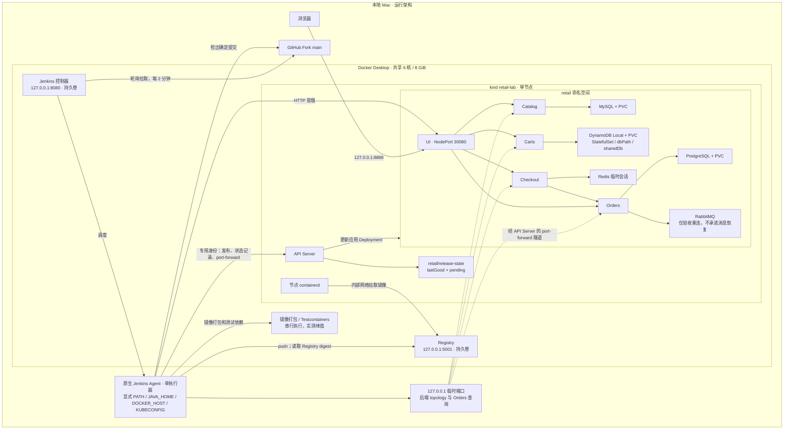

# 本地 Kubernetes 与 Jenkins 自动发布设计

状态：本文是 v3 实施前的历史设计，下面的“现状”“未部署”“本轮不继续部署”均为当时快照，不代表当前系统。当前完整架构请读 [ARCHITECTURE.md](ARCHITECTURE.md)，验收与操作见 [IMPLEMENTATION.md](IMPLEMENTATION.md)、[CHECKLIST.md](CHECKLIST.md) 和 [RUNBOOK.md](RUNBOOK.md)。文档标注更新：2026-11-03，Asia/Shanghai。

目标是在本机运行完整示例网店，并验证从 GitHub 提交到 Jenkins 测试、构建、发布及失败恢复的流程。采用单节点 kind、一个 Jenkins 控制器、一个 Mac 原生构建 Agent 和一个本地镜像仓库。先满足学习和可重复操作需要，再根据实际瓶颈增加组件。

本轮交付架构图和设计文档，不继续部署。文中的“目标”“计划”均不表示已经完成。

## 1. 现状与证据

| 项目 | 当前状态 | 证据或位置 |
| --- | --- | --- |
| GitHub Fork | 已创建 | https://github.com/HangerLIN/retail-store-sample-app |
| 本地目录 | 已克隆 | `/Users/lth/Documents/ChatGPT/k/retail-store-sample-app` |
| 基线 | main，版本 1.6.3 | 提交 `d7a380b843e0759e58754f74188ea18252a51415` |
| Git 远程 | origin 为个人 Fork，upstream 为 AWS 源仓库 | `git remote -v` |
| 工作区 | `learning/` 尚未提交 | `git status --short` |
| Docker Desktop | 已运行，分配 6 核、约 8 GiB | `docker info`；不是整台 Mac 的内存容量 |
| Compose 网店 | 曾启动 11 个容器；现已停止并移除容器 | 此前验证首页、加购及进入结账页，未证明完整下单成功；保留卷不等于所有数据库数据都持久化 |
| kind | 已创建单节点 `retail-lab`，节点 Ready | `kubectl --context kind-retail-lab get nodes` |
| Kubernetes | v1.37.0，系统 Pod 正常运行 | `get pods -A` |
| 客户端 | 仓库 `env/bin/kind` v0.33.0；`env/bin/kubectl` v1.37.0 | 系统默认 kubectl 仍为旧版，后续脚本须显式使用仓库工具 |
| 存储类 | `standard`，local-path，回收策略 Delete | `get storageclass` |
| 应用清单 | 已准备，尚未应用 | [kind 配置](kind.yaml)、[Kustomize 配置](k8s/kustomization.yaml)、[上游基线](k8s/base/retail.yaml) |
| K8s 网店 | 未部署；`retail` 命名空间尚不存在 | `get namespaces`、`get pods -A` |
| Jenkins / Registry / 自动发布 | 未搭建 | 当前无对应容器、作业或流水线验证结果 |

kind 创建命令在暂停后完成了后台执行。当前 8888 端口映射已存在，但没有网店工作负载，因此不能把端口存在当成网店可用。

本机另有 `infra-timescaledb-1` 容器运行，属于其他项目。后续脚本只能操作本项目命名的资源，禁止使用全局 Docker 清理命令。

## 2. 范围和当前阻塞

本期运行五个应用 UI、Catalog、Carts、Checkout、Orders 和五个依赖 MySQL、DynamoDB Local、PostgreSQL、RabbitMQ、Redis。保持单节点、单 main 分支、单 Agent、串行构建发布；不加入多环境、PR 自动构建、受影响服务分析、Ingress、GitOps、服务网格或监控平台。可选搜索和 AI 功能关闭。

**新增实施前置修复：Carts 当前启动逻辑会删表。** `src/cart/src/main/java/com/amazon/sample/carts/services/DynamoDBCartService.java` 的 `init()` 在 `createTable=true` 时先 `deleteTable` 再 `createTable`。当前基线 ConfigMap 开启了该开关。必须先改为“表不存在时创建、已存在时保留并校验所需索引”，处理初始化竞争；只加 PVC 不够。源码本轮尚未修改，修复和回归测试是后续实施任务。

**新增测试缺口：Checkout 的 package.json 中 test 同样是 exit 0。** 各服务必须执行真实测试并断言实际执行数大于零，不接受仅退出码成功。

## 3. 目标架构

下图是目标结构；当前只有 kind 系统组件已经运行。独立源文件为 [architecture.mmd](architecture.mmd)。

图中 Registry 拉取由节点 containerd 发起；Jenkins 主动轮询 GitHub。Agent 通过 API Server 发布，并通过网店入口和 Orders port-forward 验证业务。控制器、Registry、kind、构建与测试容器共享 Docker VM，不构成资源隔离。

### 3.1 集群和存储

- 一个 kind 节点，应用初始单副本。当前 `kind.yaml` 已明确 `listenAddress: 127.0.0.1`，网店入口 8888→NodePort 30080。
- 上游 1.6.3 YAML 保留为基线，本地调整用 Kustomize；记录下载来源、版本和校验和，初始化不用 latest。当前 overlay 只调整了 namespace 和 UI Service，以下存储、资源和权限改动尚未实施。
- MySQL、PostgreSQL 改用 local-path 的 Retain StorageClass PVC，单副本 StatefulSet，按镜像的数据路径和运行 UID/GID 验证权限。数据在 Pod 替换后必须保留。
- DynamoDB Local 改为单副本 StatefulSet，配套 governing Service 和 PVC；使用 `-dbPath`、`-sharedDb`，不得使用 `-inMemory`，按镜像用户设置写权限。替换上游 Deployment，不能让两个控制器同时存在。StatefulSet 等旧同名 Pod 完全消失再创建新 Pod；禁止 force delete/缩短为零宽限期。Deployment 的 Recreate 不能防住手工删除 Pod 时 ReplicaSet 立即补副本的窗口，RWO 也不能限制同节点多 Pod。循环加购并正常删除 DynamoDB Pod时，允许短暂不可用，但检查无实例重叠、无 SQLite 锁错误，所有已确认成功的写入和已有购物车均能恢复；失败请求不能混入成功写入计数。
- Carts 的删表逻辑先修复并构建本地镜像，之后才能验收持久化或建立可信发布基线。
- Redis 允许丢失进行中的结账会话；重启后重新发起结账必须成功。
- RabbitMQ 第一版允许临时数据丢失，不增加 PVC 和消息保留承诺。源码声明了绑定到 fanout exchange 的 `orders-orders-queue`，但 `new Queue(..., false)` 是非持久队列，已查主源码未发现业务消费者。验收改为 RabbitMQ 重启后 Orders 自动重连并继续成功下单，若重连不成立需修复；不把这当成可靠消息交付的证明。

当前 local-path 默认回收策略 Delete；计划新增 `retail-retain` StorageClass，沿用 local-path provisioner，使用 Retain 和 WaitForFirstConsumer，并明确用于三个数据库 PVC。Retain 降低 PVC/namespace 误删时自动清理数据的风险，但 PV 可能进入 Released，需要管理员手工恢复绑定；保留目录不等于服务自动恢复。PVC 存在不代表 kind 删除后仍保留数据。`stop` 只停止本项目运行资源、不删除卷和节点；`reset` 删除集群/数据前要求明确确认并提示导出。第一版不挂载 Mac 目录承载 PostgreSQL，也不加自动备份平台。验证 Docker Desktop 和 Mac 重启恢复时，需用户配合，不在部署脚本里自动重启电脑。

### 3.1.1 Carts 幂等初始化的最小改动

保持 `createTable` 开关名和 ConfigMap 的 true 值，将语义改为“缺表才创建”。先 describeTable：已存在则保留数据并校验 `idx_global_customerId`；不存在则沿用现有建表 builder 创建，捕获 ResourceInUseException 处理竞争。新建和竞争路径都要在 waiter 之后重新 describe 并验证 GSI，不能只在首次发现表存在时校验。waiter 返回的失败状态须检查；表和索引的就绪条件不足时有限等待或明确失败，不能无期限等待或删表重试。

GSI 缺失/不兼容时明确报错且不修改已有表。以现有 DynamoDB 集成测试为基础，覆盖空库建表后 GSI 查询、同容器写入后再次 init 保留数据、已有表无 GSI 时失败且原数据保留；补充竞争路径在已有表不符合要求时不会绕过校验。集群验收再重建 Carts Pod 检查购物车。评审的示意代码尚未编译，本轮未实施源码修复。

### 3.2 Jenkins 与 Agent

控制器运行在 Docker 中，绑定 127.0.0.1:8080，JENKINS_HOME 持久卷，控制器执行器为 0，启用登录并关闭匿名访问。控制器和 Registry 设置 `restart: unless-stopped`。

一个原生 Mac Agent 使用 WebSocket 连接控制器，仅一个执行器。启动脚本显式设置固定工具路径、JAVA_HOME、解析当前 Docker context 得到的 DOCKER_HOST、发布 KUBECONFIG；不得依赖交互 shell 的 PATH，也不得在发布配置缺失时回退到默认管理员 kubeconfig。

Agent 预检作业先输出不含凭据的工具版本、Docker daemon 可用性和选定 context，再运行一个实际 Testcontainers 连接检查。已核实 Catalog 测试使用 MySQL、Carts 使用 DynamoDB、Orders 使用 PostgreSQL、Checkout 使用 Redis 容器。Catalog 拼接 localhost 端口，原生 Agent 减少容器内 localhost 的适配问题；其余测试仍必须在真实 Agent 环境验证。

Checkout 固定 Yarn 4.11.0：预检包含 Node/Yarn 版本，安装使用 `--immutable`。仓库已带 `.yarn/releases/yarn-4.11.0.cjs` 和根 `.yarnrc.yml`，优先显式调用该文件，避免依赖 Node 是否附带 Corepack；如果改用 Corepack，需单独核验并固定安装版本。禁止静默使用全局 Yarn 1。

Ryuk/Testcontainers 清理能力必须在预检验证。如果自定义 DOCKER_HOST 下其 socket 映射错误，核验并显式设置 `TESTCONTAINERS_DOCKER_SOCKET_OVERRIDE=/var/run/docker.sock`；不能为了让测试变绿直接关闭 Ryuk，也不能把宿主机路径照抄成容器路径。

Agent 与用户使用同一 macOS 账号，可以访问 Docker 和用户原本能访问的文件。RBAC 是减少误操作的措施，不是对不可信代码的隔离。第一版只运行个人 Fork 的 main，不运行外部 PR。

### 3.3 镜像仓库与版本证据

Registry 主机端口绑定 127.0.0.1:5001，数据存于独立 volume，并加入 kind Docker 网络。初始化脚本为节点 containerd 写入正确的 hosts.toml，将主机镜像名 `localhost:5001` 解析到内部 Registry；每次重建集群都重复配置和验证，不能依赖上次手工修改。

镜像标签使用完整提交 SHA 加构建号；Deployment 最终按 digest 发布。digest 来自推送结果或带正确 Accept 类型的 Registry Manifest API `Docker-Content-Digest`，禁止使用本地 image ID 代替。

第一版本地 ARM64，可使用 `--provenance=false` 减少 index 复杂度，但不能假定它一定得到单 manifest。归档：Registry 顶层 digest、必要时 ARM64 子 manifest digest、Deployment spec 和 Pod imageID。spec 必须等于所选 Registry 顶层 digest；imageID 若为平台子 digest，必须证明它属于该 index，不能直接比较不同层级摘要。镜像及回滚所需 manifest 不得被清理。

## 4. 真实配置和业务验收路径

以下是当前基线 YAML 的已核实值，不代表集群运行时已经采用：

| 应用 | 必须断言的 provider | 必须断言的 endpoint |
| --- | --- | --- |
| Catalog | `RETAIL_CATALOG_PERSISTENCE_PROVIDER=mysql` | `RETAIL_CATALOG_PERSISTENCE_ENDPOINT=catalog-mysql:3306` |
| Carts | `RETAIL_CART_PERSISTENCE_PROVIDER=dynamodb` | `RETAIL_CART_PERSISTENCE_DYNAMODB_ENDPOINT=http://carts-dynamodb:8000` |
| Orders | `RETAIL_ORDERS_PERSISTENCE_PROVIDER=postgres`；`RETAIL_ORDERS_MESSAGING_PROVIDER=rabbitmq` | `RETAIL_ORDERS_PERSISTENCE_ENDPOINT=orders-postgresql:5432`；`RETAIL_ORDERS_MESSAGING_RABBITMQ_ADDRESSES=orders-rabbitmq:5672` |
| Checkout | `RETAIL_CHECKOUT_PERSISTENCE_PROVIDER=redis` | `RETAIL_CHECKOUT_PERSISTENCE_REDIS_URL=redis://checkout-redis:6379`；`RETAIL_CHECKOUT_ENDPOINTS_ORDERS=http://orders:80` |
| UI | 无上述 persistence provider；检查四个后端地址避免 mock | `RETAIL_UI_ENDPOINTS_CATALOG=http://catalog`；`RETAIL_UI_ENDPOINTS_CARTS=http://carts`；`RETAIL_UI_ENDPOINTS_CHECKOUT=http://checkout`；`RETAIL_UI_ENDPOINTS_ORDERS=http://orders` |

配置校验分三层，取消 Jenkins 内自写 envFrom 覆盖优先级解析器：

1. 对 Kustomize 渲染的期望 Deployment 和 live Deployment/Pod 中的 `env`、`envFrom`、`command`、`args` 做结构化比较，保持数组顺序，只规范化 API 的空值/default 表示，不比较 image。多余覆盖一律拒绝。非镜像配置变更先由管理员应用，Jenkins 不用更新镜像去“修复”漂移。
2. 管理员初始化脚本有权读 Secret，按精确 allowlist 只允许凭据键，禁止 provider、endpoint、URL、address 等配置键混入 Secret，并检测 Deployment/StatefulSet/Pod spec 中密码字面量。优先用显式 secretKeyRef 注入凭据，避免整包 envFrom.secretRef。此检查是初始化/凭据变更的管理员职责；发布身份不能声称审计了自己不可读的 Secret。
3. 将服务 topology 作为运行时配置的主要证据，同时保留真实数据链路测试。已核实 Catalog 返回加载后的 config.Database；Carts/Orders 返回 Spring 注入的 provider/properties；Checkout 使用 ConfigService 返回 persistence provider 与 Redis URL。UI `/topology` 是按 EndpointProperties 聚合的 HTML；Checkout 的 topology 不返回 Orders endpoint，所以这些接口不能单独证明所有端点或实际数据库连通。Agent 顺序 port-forward 四个后端读取 topology JSON，对未暴露的字段依靠 spec 比对和真实 Orders 读回交叉验证，不把健康接口当连通证明。

应用非敏感配置改为 `configMapGenerator` 带名称 hash，由管理员应用后触发 Pod 模板更新。overlay 应先移除基线中同名静态 ConfigMap，再生成并验证所有 envFrom 引用都被改写；不把 release-state 放入 generator。Jenkins 可读 retail 内所有非敏感 ConfigMap，仍只能写指定 release-state。禁止原地改旧 hash ConfigMap，保留当前引用的配置，并逐项比对 live 数据与渲染内容；已运行进程的证据来自 topology，不假设 ConfigMap 更新后环境变量会热更新。

lastGood 同时记录已验证的非镜像配置指纹（env/envFrom/command/args 及 ConfigMap 内容）。镜像回滚只对这个已验证配置有效；管理员变更配置后须验证并重建 lastGood 的配置基线。若指纹漂移，先停止镜像发布并完成管理员配置协调，不能回滚镜像后就声称恢复了旧版本的完整行为。

日常冒烟通过 localhost:8888 完成加购和模拟下单，记录本次唯一测试标识和订单 ID。使用发布 kubeconfig 将 `svc/orders` 转发到 127.0.0.1 的临时可用端口，调用已存在的 GET `/orders` 并找到本次订单内容；不直接查数据库，不使用 exec 或读取 Secret。脚本等待隧道建立、限时运行，并在成功/失败/中断后清理进程；重跑不得留下占用端口的旧隧道。

订单接口读回本身不证明跨重启持久化。初始化验收另由管理员重建数据库 Pod、Carts/Orders 应用 Pod 后，用相同业务标识继续通过接口读取。已核实 GET `/orders` 返回 repository.findAll 的完整列表，无分页或过滤；使用下单响应中的 id 精确匹配，再检查商品与虚构地址字段。短期学习接受测试订单累积，手册提示长期运行要人工管理测试数据；不依赖不存在的服务端过滤参数。发布身份不获删除 Pod 或数据库维护权限。冒烟数据为虚构数据，不输入真实个人或支付信息。Carts 新增条目 quantity 固定为 1，item 对不存在对象使用 Optional.of 可能抛异常；本期不修这两个上游行为，冒烟只以单件新增为基线，不用删除不存在条目作为清理或成功断言。

## 5. 发布流水线和可靠回滚点

单个 Jenkins Pipeline 轮询 main：`H/2 * * * *`，同一作业禁止并发。增加参数 `ACTION=deploy|reconcile`：reconcile 不构建、不发布候选，只修复 pending/漂移并验证；任务 aborted 或恢复启动后需手动运行一次，无新提交的 SCM 轮询不会自动触发它。Checkout 后与 `lastGood.sourceSha` 比较文件变化：只有明确属于文档/图片说明的变化才跳过测试构建发布；`src/**`、`learning/k8s/**`、`learning/kind.yaml`、Jenkinsfile、流水线脚本、根级构建/依赖配置变化必须进入相关检查。不确定路径、首次构建、基准不可用或显式强制构建按需要处理，不用只匹配 `src/**` 的粗略白名单漏掉流水线修改。

部署清单或基础设施变化只触发验证，并报告需管理员应用；Jenkins 不自动变更数据库/PVC/Secret。若现有基础设施不满足新 revision 的预期配置，停止自动发布并报告原因。需要应用发布时仍串行测试和构建五个服务，不做服务级影响分析。

| 阶段 | 行为 | 失败结果 |
| --- | --- | --- |
| Checkout / Classify | 固定 SHA，记录变化分类；文档提交跳过交付，不改 lastGood | 中止或明确 skipped |
| Validate / Test | 验证清单、工具和配置；真实测试，逐服务实际执行数大于零 | 不改应用版本 |
| Build / Push | 串行构建五服务；推送并记录 Registry digests | 不改应用版本 |
| Preflight / Reconcile | 检查 context、namespace、发布权限、Registry、provider；读取 release-state | 仅结构/权限等前提不满足时阻断，不因业务不健康直接拒绝修复 |
| Deploy | 先写 pending；逐个更新应用，逐个 rollout status --timeout，再处理下一个 | 按 lastGood 恢复 |
| Verify | 真实加购下单、Orders 读回；核对五个镜像和所有应用健康 | 按 lastGood 恢复 |
| Record | 验证成功后，单次带 resourceVersion 的 ConfigMap 更新提交五镜像 lastGood 并清除 pending；归档证据 | 写入失败仍是未完成发布，保留 pending 供重跑恢复 |

### 5.1 release-state 协议

初始化由管理员预建 `retail/release-state` ConfigMap。它只保存非敏感数据：`lastGood`（已验证五镜像 digest、源码版本、非镜像配置指纹、验证时间）、`pending`（本次目标 digest、构建号、开始时间）。不存 token，不使用外部数据库或复杂工作流引擎。

- 初始化上游网店是候选基线；必须先修复 Carts 删表行为、钉住实际镜像 digest，并完成业务和持久化验证，再显式建立第一个 lastGood。首次基线先使用本地构建并验证的五服务镜像，统一保存在 Registry 且固定 digest，避免依赖外部 ECR 可达性。第一次普通 Jenkins 发布因此有可信回滚点。没有 lastGood 时先走管理员初始化及验证流程，记录“无已验证回滚点”；普通发布不跳过该前提，也不得用现场混合镜像冒充基线。
- 普通发布前发现 pending，或当前五个 spec digest 与 lastGood 不同，先尝试恢复 lastGood 并验证；成功后清理旧 pending，再发布候选版本。
- 业务不健康但镜像未漂移时允许已通过测试的修复候选发布。删除 RECOVERY 参数：在 ACTION=deploy 下，如果恢复失败仅属应用 rollout/业务健康失败，而且 API、权限、存储资源、配置指纹、候选和 lastGood 镜像可达性等前提都满足，记录 recovery-failed 后允许发布候选。若存储/PVC 缺失、配置漂移、API 不可达、权限不足等结构性故障则停止，不能断言“失败后直接发总不会更糟”。ACTION=reconcile 失败时直接报告失败，不转成 deploy。只有新候选完整 Verify 成功才提交新的 lastGood，记录恢复失败的历史。
- Deploy 前用 Registry HEAD manifest 核对 lastGood 的五个 digest 和候选五个 digest 可取；Registry 内 index 的本地平台子 manifest 同样检查。lastGood 镜像缺失时先恢复镜像或显式重新 bootstrap，不能静默承诺可回滚。普通流水线不实现临时复制公共镜像并声称 digest 一定不变。
- Deploy 前写 pending 成功才允许更改镜像。Agent 掉线、Mac 休眠或控制器中断时不依赖 finally/post 执行；下次从 ConfigMap 判断未完成状态。Verify 成功后才更新 lastGood。并发禁用覆盖整项作业；手工维护期间停止作业，ConfigMap resourceVersion 冲突不能盲目覆盖。
- 回滚恢复 lastGood 的五个镜像，逐个等待和冒烟；回滚失败明确报失败。回滚点不取自本次 Preflight 快照。

部署顺序固定为 Orders→Checkout→Carts→Catalog→UI，每个应用点名 `rollout status --timeout` 成功后才继续；这仅减少窗口，不消除跨服务兼容要求。单副本用 `maxSurge: 0`、`maxUnavailable: 1` 减少更新峰值，接受短暂不可用和过渡期间的新旧混合，不承诺跨五服务原子发布。原清单五应用都有 readinessProbe：Catalog/Checkout 为 `/health`，Java 应用为 `/actuator/health/readiness`；仍需确认探针的实际行为，不能把 Ready 代替业务冒烟。应用启动迁移须兼容旧版本，破坏性数据库迁移不在自动回滚承诺内。

### 5.2 测试覆盖

Catalog test/lint 是占位 exit 0；Checkout test 也是 exit 0，真实测试位于 `test/*.e2e-spec.ts`，用其 jest-e2e 配置执行。Java 服务执行各自 Maven 测试配置，确保集成测试 tag 未被排除。逐服务解析 Go JSON、JUnit XML 或 Jest JSON 等报告，要求实际运行的非 skipped 测试数大于零，报告缺失/零测试均失败。具体命令和数量实施时在 Agent 上核实并归档，不能复用陈旧报告。当前 Checkout 的 src 下未发现 *.spec.ts，不虚构一个必须通过的单元测试集合；默认 Jest rootDir=src，而 test/ 中有 app 和 chaos 两套 e2e，必须用 jest-e2e 配置执行并取得非零结果。将来增加 src 单测后再加入单测阶段。

### 5.3 发布身份

所有命令显式使用专用发布 KUBECONFIG、context 和 namespace。初始化管理员预建资源，日常身份不执行全量 apply。

| 资源范围 | 允许操作 |
| --- | --- |
| 指定五个应用 Deployment | get / patch，以及实际 rollout 客户端需要的受限 watch；按 resourceNames 验证客户端兼容性，不默认扩大写权限 |
| retail 内 Pod、ReplicaSet、Event、Service、Pod logs | get/list/watch 中实际所需的读取；logs get |
| retail 内 pods/portforward | 先配置 create，按固定 kubectl v1.37 的真实 WebSocket/SPDY 调用核验是否还需要 get；不可泛化授予所有子资源。明确是 namespace 级能力，不声称只限制 Orders |
| retail 内非敏感 ConfigMap | get，支持带 hash 的配置名；禁止将密码放入 ConfigMap |
| 唯一 release-state ConfigMap | get/update/patch，初始化由管理员创建；使用 resourceVersion 进行状态提交 |

脚本逐个点名 get Deployment，不用裸 get deploy；resourceNames 限制下的 list/watch 需 metadata.name field selector，必须执行真实 rollout 命令验证客户端请求。port-forward 必须实际验证 Service get、Pod list/get 和子资源权限，不仅检查 auth can-i。管理员扫描所有 Deployment/StatefulSet 和 Pod，禁止凭据以字面 env value 出现；基线 MySQL root 密码字面量须改为 secretKeyRef。能读 spec 和 namespace 级 port-forward 仍有访问面，禁读 Secret 不等于隔离数据库。

Secret 读取、pods/exec、PVC 删除和其他命名空间写入仍禁止。验证 Orders port-forward 可用，同时 `auth can-i create pods/exec` 和 `auth can-i get secrets` 为 no。

按个人可信学习环境简化为管理员手工创建的专用 ServiceAccount 长期 token，私密 kubeconfig 文件权限 0600 或 Jenkins Credentials；不提交 Git、不输出 token，删除/重建对应 token Secret 可撤销。取消日常到期刷新机制；这与官方优先推荐短期 token 的生产实践不同，迁云或扩大使用者后重新设计。不能把显式 KUBECONFIG 说成阻止同一 macOS 用户读取管理员凭据的强隔离。

## 6. 资源预算和重启边界

调度器看不到 Jenkins、Registry、Docker 构建、Testcontainers 和其他项目容器的完整竞争关系。Pod requests 小于 Node Allocatable 不能证明 8 GiB 安全；VM OOM 可能影响非 K8s 容器，且原生 Agent 编译还消耗 Mac 内存。

初始控制器堆 512 MiB、容器约 1 GiB 限制；Java 应用明确容器 limits 和合理的 `-XX:MaxRAMPercentage`，为堆外内存留空间。Dockerfile 的多阶段构建可能重复编译，构建阶段和 Testcontainers 必须都计入预算，测试结束清理测试容器，串行运行。

本机物理内存已测为 16 GiB，Docker 配额约 8 GiB。2026-11-03 本轮快照只有空 kind 节点约 569 MiB 和 timescaledb 约 95 MiB，网店和 Jenkins 尚未启动；这不是完整基线。

先采集空闲与业务运行时 `docker stats`、宿主机内存和节点 capacity/allocatable，再测完整测试与构建的最高峰。记录所有项目容器；`infra-timescaledb-1` 计入预算，不自行暂停它。

决策门槛：完整网店 + Jenkins + Registry + timescaledb 的稳定基线若接近/超过约 5 GiB（经验触发点，不是安全硬标准），先停止进入全量构建，检查 Mac memory pressure、swap 趋势及原生编译所需余量。余量允许时优先评估 Docker 10 GiB；16 GiB Mac 不直接默认给 Docker 12 GiB。宿主机余量不足时明确报告容量约束并调整构建计划或所需资源，不硬跑也不宣布成功。即使低于 5 GiB，也必须完成峰值验证。

计划通过 kubelet reservation 和 eviction 阈值减少可调度内存，先以约 2 GiB 的非业务余量为测量起点，再据峰值修正。但 `kubeReserved` 原义是 kubelet/runtime 预留，不是给 Jenkins 创建受保护的内存池；Docker 外层资源限制和构建并发仍需控制。实施时核验 kind 节点实际 cgroup、Node Allocatable 和 kubelet 生效配置，不能只在 YAML 写一个 2 GiB 数字就宣布解决 VM OOM。已有节点是否需重建以工具能力为准，重建前走 reset 的数据确认流程。

不默认给现有 kind 节点执行 docker update 内存硬限制；它可能把 OOM 转移到 kubelet/containerd，属于需要单独测量的兜底实验。峰值验证前开启 `docker events --filter event=oom` 并归档持续窗口和事件，覆盖 Docker daemon 连接中断的情况，不能把采集失效当零事件。

验收需同时检查 Pod OOMKilled/驱逐、Docker 容器 OOMKilled/退出及 restart count、Jenkins 与 API Server 连续可用性。若达不到，调整预算或在确认 Mac 余量后增加 Docker 配额，不能关闭业务服务伪装完成。

明确 stop：先停止 Jenkins 接收构建，等待作业和隧道结束，再停原生 Agent、控制器/Registry 容器及现有 kind 节点容器，不删容器、PVC、namespace 或 volume，也不通过缩副本模拟关机。start 用 docker start 恢复相同容器，按依赖等待系统与应用就绪，再启动 Agent；reset 才负责删除/重建且要求确认。两者只操作本项目的显式资源名。保留具名卷；控制器和 Registry 自动重启策略并不保证退出的 kind 节点或 Mac Agent 会自动恢复，需有幂等 start/check 脚本。验证 Docker Desktop 和 Mac 重启后按约定启动流程恢复应用和历史数据；若要求无人干预启动，单独实现并验证登录启动项。自动化验收期间用 caffeinate 保持唤醒，Mac 合盖/休眠会暂停轮询和 Docker，不能承诺全天候服务。

## 7. 实施顺序与完成证据

以下仍为待实施，源码行为确认不等于运行测试通过。

1. 修复 Carts 幂等建表并增加已有购物车跨应用重启不被清空的回归测试；接入 Checkout 等五服务真实测试，报告非零。
2. 准备 Registry、镜像拉取网络、PVC、DynamoDB StatefulSet/启动参数/权限、资源预算和限定 RBAC；保留原始基线，overlay 表达变更。验证 `get nodes` 及 Registry push/pull。
3. 部署完整网店并验证五服务真实 provider、endpoint、实例配置及核心下单；重建 MySQL/PostgreSQL/DynamoDB 和应用 Pod 后数据仍可读。DynamoDB 文件检查由管理员执行，日常 Jenkins 冒烟不需要 exec。
4. RabbitMQ 重启后 Orders 自动重连并继续下单；Redis 重启后可新建会话。完成后记录初始 lastGood 五镜像 digest 和配置指纹。
5. 建立 Jenkins 控制器与原生 Agent；预检脚本在非交互环境工作；管理员凭据不可作为发布配置缺失的后备。
6. 推送真实改动，轮询自动构建发布；验证 Registry/spec/imageID 的正确对应关系和业务改动。只改文档的提交明确跳过发布且不改 lastGood。
7. 验证测试失败不发布、rollout 失败恢复 lastGood、Deploy 期间 kill Agent 后在无新提交时手工 ACTION=reconcile 恢复，再发布、业务已坏时修复候选不会被健康前置检查永久挡住。故障注入只作用于本地实验资源。
8. 用发布 kubeconfig 跑完整冒烟和 Orders 查询；核验 exec/Secret 读取/PVC 删除被拒绝；release-state 正常更新但不能修改其他 ConfigMap。
9. 观察全量测试/构建/网店共存时的峰值，无 OOM/不可接受驱逐/Jenkins 重启。保留证据，不能只加 requests 就算通过。
10. 经用户协调验证 Docker Desktop 与 Mac 重启后的恢复、数据与 Jenkins 历史保留，交付 start/stop/reset 和故障排查说明。需配合的重启验证未完成时标记未验证，不宣称整个目标完成。

## 8. 评审材料和参考

本次另附 [REVIEW_RESPONSE.md](REVIEW_RESPONSE.md)，逐条记录采纳情况、源码位置和未验证项。提供离线评审 ZIP，包含基线提交的全部受 Git 管理源码及当前 learning/ 文件，排除 .git、env/、工具二进制、kubeconfig、Docker 数据和本地凭据；无需仅凭设计文档推测源码。

- [Node Allocatable 与预留机制](https://kubernetes.io/docs/tasks/administer-cluster/reserve-compute-resources/)
- [ServiceAccount 长期 token 的手工创建](https://kubernetes.io/docs/tasks/configure-pod-container/configure-service-account/)
- [kind 本地 Registry](https://kind.sigs.k8s.io/docs/user/local-registry/)
- [Jenkins 控制器隔离](https://www.jenkins.io/doc/book/security/controller-isolation/)
